# Laboratorio 02

## Diseño, simulación e implementación de una ALU de 4 bits

---

## Integrantes  

- Julian David Gomez Gonzalez - 1007544331
- Cristian Norbey Hernández Gualteros - 1001091723
- Milton Nicolas Rincón Caicedo - 1021312724

**Semestre:** 2026-2

---

## Índice

1. [Explicación general del funcionamiento](#1-explicación-general-del-funcionamiento)
2. [Descripción de la arquitectura propuesta](#2-descripción-de-la-arquitectura-propuesta)
3. [Explicación de los módulos desarrollados](#3-explicación-de-los-módulos-desarrollados)
4. [Tabla de operaciones implementadas](#4-tabla-de-operaciones-implementadas)
5. [Almacenamiento de operandos](#5-almacenamiento-de-operandos)
6. [Conservación del código de operación](#6-conservación-del-código-de-operación)
7. [Indicadores visuales (LED RGB)](#7-indicadores-visuales-led-rgb)
8. [Simulaciones y Comportamiento Observado en GTKWave](#8-simulaciones-y-comportamiento-observado-en-gtkwave)
9. [Evidencia de la implementación funcional en FPGA](#9-evidencia-de-la-implementación-funcional-en-fpga)
10. [Conclusiones](#10-conclusiones)

---

## 1. Explicación general del funcionamiento

En este informe, se implementó en la FPGA Zybo Z7 una Unidad Aritmético-Lógica (ALU) de 4 bits, que es el bloque de un procesador encargado de hacer las operaciones matemáticas y lógicas. La ALU recibe dos operandos de 4 bits (`A` y `B`) y un código de operación de 2 bits (`op`), realiza y entrega un resultado de 4 bits, que puede ser: suma, resta, AND o OR de los operandos.

Como la tarjeta solo tiene 4 switches, los dos operandos se ingresan uno después del otro por el mismo bus de datos. El sistema funciona de la siguiente manera:

1. Se coloca un valor en los switches `SW[3:0]` y se presiona `BTN0`, ese valor queda guardado como operando A.
2. Se cambian los switches y se presiona `BTN1`, el nuevo valor queda guardado como operando B. Desde ese momento se pueden mover los switches sin que cambien los operandos.
3. Cada vez que se presiona `BTN2` se invierte el bit 0 del código de operación, y cada vez que se presiona `BTN3` se invierte el bit 1. El código queda guardado, así que no hay que dejar los botones presionados.
4. La ALU calcula el resultado con los valores guardados y lo muestra en los LEDs `LED[3:0]`.
5. El LED RGB muestra un color distinto según la operación: verde para la suma, rojo para la resta, azul para el AND y morado para el OR.

Al encender la tarjeta todos los registros empiezan en cero, por lo que la operación inicial es la suma (00).

---

## 2. Descripción de la arquitectura

El sistema sigue la estructura de un datapath sencillo, donde se separó la parte secuencial (los registros, donde se guarda la información) de la parte combinacional (la ALU, que procesa). El funcionamiento se divide en tres etapas.

### 2.1. Entrada y almacenamiento

Como la FPGA tiene pocas entradas físicas, se usa el mismo bus de 4 switches para los dos operandos, pero en momentos distintos. Los switches están conectados a la vez a los registros `Reg_A` y `Reg_B`, y los botones `BTN0` y `BTN1` funcionan como señal de habilitación: al presionar uno de ellos, el registro correspondiente guarda lo que hay en los switches. Un tercer registro, `Reg_Op`, guarda el código de operación de 2 bits, que se modifica con `BTN2` y `BTN3` después de pasar por un circuito antirrebote. Todos los registros trabajan con el reloj de la tarjeta (`clk`).

### 2.2. Procesamiento (lógica combinacional)

Las salidas de los registros llegan a la ALU. La ALU no tiene reloj ni memoria, por ende, solo toma los valores que tiene en ese momento `Reg_A`, `Reg_B` y `Reg_Op` y calcula el resultado.

### 2.3. Salida

El resultado de 4 bits de la ALU va a los LEDs de la tarjeta. Al mismo tiempo, el valor de `Reg_Op` entra a un decodificador que enciende el LED RGB con el color de la operación activa.

**Diagrama de bloques (datapath)**

```mermaid
graph LR
    SW[Switches 3:0] --> |Bus de Datos| RegA(Registro A)
    SW --> |Bus de Datos| RegB(Registro B)
    
    BTN0((BTN 0)) -.-> |Señal Enable| RegA
    BTN1((BTN 1)) -.-> |Señal Enable| RegB
    BTN2_3((BTN 2 y 3)) --> |Cambio de Bit| RegOp(Registro OpCode)

    RegA --> |4 bits| ALU{ALU 4-bits}
    RegB --> |4 bits| ALU
    RegOp --> |2 bits| ALU

    ALU --> |Resultado 4 bits| LEDs[LEDs Salida]
    RegOp --> |Decodifica Color| RGB[LED RGB]

    style LEDs fill:#CC5500,stroke:#333
    style RGB fill:#CC5500,stroke:#333
    style SW fill:#CC5500,stroke:#333
    style BTN0 fill:#013220,stroke:#333
    style BTN1 fill:#013220,stroke:#333
    style BTN2_3 fill:#013220,stroke:#333
    style ALU fill:#950606,stroke:#333,stroke-width:2px
    style RegA fill:#003153,stroke:#333
    style RegB fill:#003153,stroke:#333
    style RegOp fill:#003153,stroke:#333

```

---

## 3. Módulos

El la tabla se resume, la función de los módulos implementacdos:


| Módulo | Función |
| :--- | :--- |
| `alu` | Hace la operación indicada por `op` con `A` y `B`. |
| `registro` | Registro de 4 bits con carga; se usa para el operando A y para el operando B. |
| `antirrebote` | Limpia la señal de un botón y entrega un pulso de un ciclo por cada pulsación. |
| `control_op` | Registro de 2 bits que guarda el código de operación. |
| `top` | Módulo superior: conecta los pines de la FPGA con los demás módulos. |
| `rgb_decoder` | Convierte el código de operación en el color del LED RGB. |

La ALU es el único módulo que hace operaciones, y es puramente combinacional, no usa reloj y tampoco guarda ningún valor. Todos los elementos con memoria (`registro`, `antirrebote` y `control_op`) están en `almacenamiento.v`, y el módulo `top` solo instancia y conecta los demás módulos con los pines de la FPGA.

El módulo `antirrebote` solo se usa en los botones de operación (`BTN2` y `BTN3`). Sincroniza la señal del botón con el reloj, ignora los cambios que duren menos de 10 ms y entrega un único pulso por pulsación. Los botones de carga (`BTN0` y `BTN1`) no lo necesitan, porque mientras están presionados el registro vuelve a cargar el mismo valor de los switches y los rebotes no cambian nada.
Una explicación de cada línea de el código se encuentra, dentro de los comentarios de del código en la carpeta /src.

## 4. Tabla de operaciones implementadas

En la siguiente tabla están las operaciones que puede hacer la ALU. Cada una se selecciona con el código de 2 bits y trabaja sobre operandos de 4 bits.

| Código de Operación | Operación | Función Ejecutada |
| :---: | :--- | :--- |
| `00` | Suma | `A + B` |
| `01` | Resta | `A - B` |
| `10` | AND lógico | `A AND B` (bit a bit) |
| `11` | OR lógico | `A OR B` (bit a bit) |

---

## 5. Almacenamiento de operandos

La tarjeta Zybo Z7 solo tiene 4 switches (`SW[3:0]`), pero el sistema necesita dos operandos de 4 bits (`A` y `B`). Por eso los operandos se ingresan en momentos distintos y cada uno se guarda en un registro.

### 5.1. Arquitectura de los registros

Se usan dos registros de 4 bits, `Reg_A` y `Reg_B`. En la FPGA cada uno se implementa como 4 flip-flops tipo D que trabajan con el reloj del sistema (`clk`).

Las entradas de datos de ambos registros están conectadas en paralelo al mismo bus de los switches (`SW[3:0]`). Lo que decide cuál de los dos guarda el dato es la señal de carga: `BTN0` habilita a `Reg_A` y `BTN1` habilita a `Reg_B`.

### 5.2. Implementación en Verilog

El registro se describe una sola vez en el módulo `registro` (`src/almacenamiento.v`), con un bloque `always` que trabaja en el flanco de subida del reloj y una asignación no bloqueante (`<=`):

```verilog
module registro (
    input  wire       clk,
    input  wire       load,           // 1 = cargar el dato, 0 = conservar
    input  wire [3:0] d,              // dato de entrada (bus de switches)
    output reg  [3:0] q = 4'b0000     // valor guardado (arranca en 0)
);
    always @(posedge clk) begin
        if (load)
            q <= d;     // captura el valor de los switches
        // si load = 0 no se asigna nada: q conserva su valor
    end
endmodule
```

En el módulo `top` se instancia dos veces, una por operando, y las dos instancias están conectadas AL MISMO bus `sw`:

```verilog
registro reg_A (.clk(clk), .load(btn[0]), .d(sw), .q(reg_a));
registro reg_B (.clk(clk), .load(btn[1]), .d(sw), .q(reg_b));
```


Mientras un botón de carga no esté presionado (`btn = 0`), el registro no se actualiza, en cada flanco de reloj los flip-flops mantienen su valor ($Q_{t+1} = Q_t$), sin importar lo que pase en los switches.

Esto es lo que permite cargar los operandos por separado. Después de guardar A con `BTN0`, se pueden mover los switches para preparar B sin afectar a `Reg_A`, porque `BTN0` ya no está presionado. `Reg_B` solo cambia cuando se presiona `BTN1`.

Como resultado, la ALU siempre recibe los valores guardados en `reg_A` y `reg_B`, y no lo que haya en ese momento en los switches.

---

## 6. Código de operación

Para no tener que mantener los botones presionados mientras se lee el resultado, el código de operación (`op`) también se guarda en un registro.


Se usa un registro de 2 bits, `Reg_Op`, formado por dos flip-flops tipo D que trabajan con el reloj `clk`. Cada botón controla uno de sus bits: `BTN2` modifica el bit menos significativo (`reg_op[0]`) y `BTN3` el más significativo (`reg_op[1]`).

Así, basta con presionar y soltar `BTN2` o `BTN3` para cambiar el bit correspondiente, y el nuevo valor se queda guardado en los flip-flops.

### 6.3. Implementación en Verilog

`Reg_Op` está implementado en el módulo `control_op` (`src/almacenamiento.v`). Su valor inicial es `2'b00` (suma), por eso al encender la tarjeta el LED RGB aparece en verde.

El registro no se controla directamente con el nivel de los botones. Con un reloj de 125 MHz, una pulsación normal (unos 100 ms) dura más de 12 millones de ciclos, y si el bit se invirtiera en cada ciclo mientras el botón está presionado, el valor final sería aleatorio. Además, los contactos del botón rebotan al presionarlo. Por eso cada botón pasa primero por el módulo `antirrebote` (sección 3.2), que entrega un solo pulso de un ciclo por pulsación, y es ese pulso el que invierte el bit:

```verilog
module control_op (
    input  wire       clk,
    input  wire       pulso_bit0,     // pulso limpio de BTN2
    input  wire       pulso_bit1,     // pulso limpio de BTN3
    output reg  [1:0] op = 2'b00      // arranca en 00 (suma)
);
    always @(posedge clk) begin
        if (pulso_bit0)
            op[0] <= ~op[0];          // invierte el bit 0
        if (pulso_bit1)
            op[1] <= ~op[1];          // invierte el bit 1
    end
endmodule
```

Partiendo de la suma, una forma de recorrer las cuatro operaciones es: Suma `00` → (BTN2) → Resta `01` → (BTN3) → OR `11` → (BTN2) → AND `10` → (BTN3) → Suma `00`.

En la tarjeta, cada pulsación produce un solo pulso y el flip-flop correspondiente se invierte una sola vez. Al soltar el botón (`btn = 0`), los flip-flops simplemente mantienen su valor, y el código queda guardado hasta la siguiente pulsación.


---

## 7. Indicadores visuales (LED RGB)

Para saber qué operación está seleccionada se usa el LED RGB de la Zybo Z7. Los colores de la suma y la resta son los que pide la guía para el AND y el OR el grupo escogió azul y morado, que se distinguen bien de los otros dos.

| Código `op` | Operación activa | Color del LED RGB | `{R, G, B}` |
| :---: | :--- | :--- | :---: |
| `00` | Suma | Verde | `010` |
| `01` | Resta | Rojo | `100` |
| `10` | AND | Azul | `001` |
| `11` | OR | Morado | `101` |

El color lo genera el módulo combinacional `rgb_decoder` a partir del valor guardado en `reg_op`, y se envía al LED RGB 6 (LD6). El morado se obtiene encendiendo al mismo tiempo el rojo y el azul. Como el color depende del registro y no de los botones, se mantiene después de soltarlos.

---

## 8. Simulaciones y Comportamiento Observado en GTKWave


El testbench está organizado en 6 pruebas. En las ondas se observar que la ALU entrega los resultados esperados y que se comporta de forma combinacional.

### Prueba 1: Operación Suma (`op = 00`)

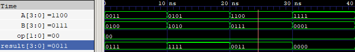

Se probaron 4 combinaciones, incluyendo casos normales y casos con desbordamiento (el resultado se limita a 4 bits):

- `0011 + 0100 = 0111`.
- `0101 + 1010 = 1111`, el valor máximo que se puede representar con 4 bits.
- `1100 + 0111 = 10011`. Como el resultado no cabe en 4 bits, se pierde el bit más significativo y la ALU entrega `0011`.
- `1111 + 0001 = 10000`. Por la misma razón, la salida es `0000`.

### Prueba 2: Operación Resta (`op = 01`)

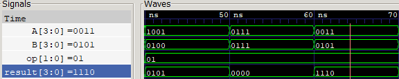

Se probaron 4 combinaciones para revisar restas con resultado positivo, cero y negativo (en complemento a 2):

- Restas con resultado positivo o cero: `1001 - 0100 = 0101` y `0111 - 0111 = 0000`.
- Restas con resultado negativo: `0011 - 0101` da `1110`, que en complemento a 2 de 4 bits corresponde a `-2`. De la misma forma, `0000 - 0001` da `1111`, es decir, `-1`.

### Prueba 3: Operación Lógica AND (`op = 10`)

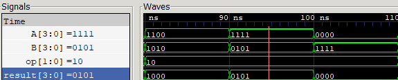

Se probaron 3 combinaciones para revisar la operación bit a bit:

- `1100 & 1010` da `1000`: solo queda en `1` la posición en la que ambos operandos tienen un `1`. También se probaron `1111 & 0101 = 0101` y `0000 & 1111 = 0000`.

### Prueba 4: Operación Lógica OR (`op = 11`)

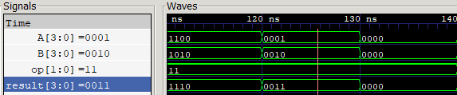

Se probaron otras 3 combinaciones para la operación OR bit a bit:

- `1100 | 1010` da `1110`. También se probaron `0001 | 0010 = 0011` y `0000 | 0000 = 0000`.

### Prueba 5: Mismos operandos, cambio dinámico de operación

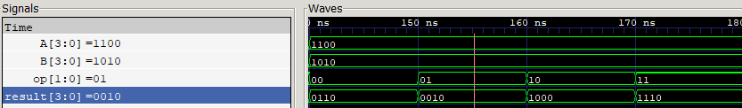

En esta prueba se dejaron fijos los operandos `A = 1100` y `B = 1010` y solo se cambió `op`, pasando por `00`, `01`, `10` y `11`. En la onda se ve que `result` cambia en el mismo instante que `op` (`0110`, `0010`, `1000` y `1110`). Como no hay retardo ni se espera ningún flanco de reloj, esto confirma que la ALU es combinacional, como lo pide la sección 4.2 de la guía.

### Prueba 6: Operador fijo, cambio dinámico de operando A

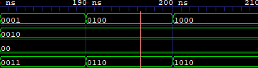

Por último, se dejó fija la suma (`op = 00`) con `B = 0010` y se cambió solo el operando `A` (`0001`, `0100` y `1000`). La salida `result` siguió esos cambios de inmediato (`0011`, `0110` y `1010`), lo que muestra que la ALU responde a cualquier cambio en sus entradas.

---

## 9. Evidencia de la implementación funcional en FPGA

El diseño se sintetizó y se cargó en la Zybo Z7. Para la prueba en hardware se usaron los operandos `A = 1010` y `B = 0101` y se pasó por las 4 operaciones.

Estas son las fotos de la prueba, paso a paso:

### Paso 1: Carga del Operando A

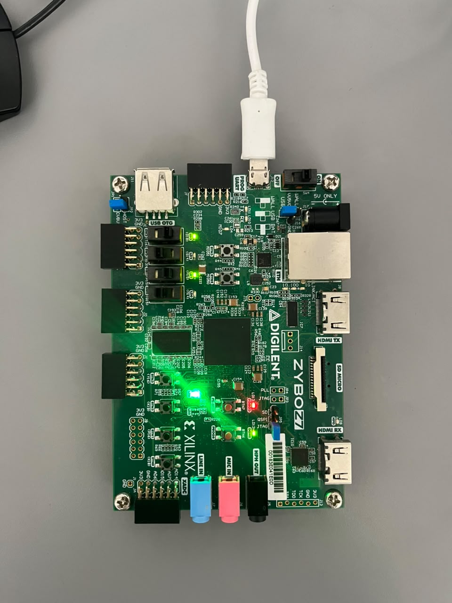

Se pusieron los switches en `1010` y se presionó `BTN0` para guardar el operando A. En este punto el LED RGB está en verde, porque la operación inicial es la suma.

### Paso 2: Carga del Operando B

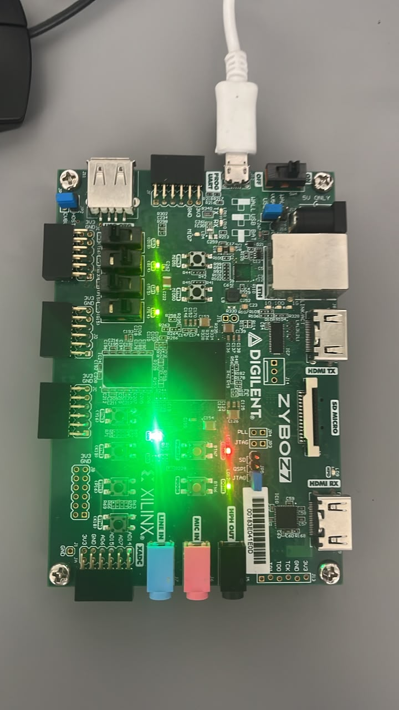

Se cambiaron los switches a `0101` y se presionó `BTN1`. Mover los switches no afectó el valor `1010` que ya estaba guardado en el operando A.

### Paso 3: Operación Suma activa

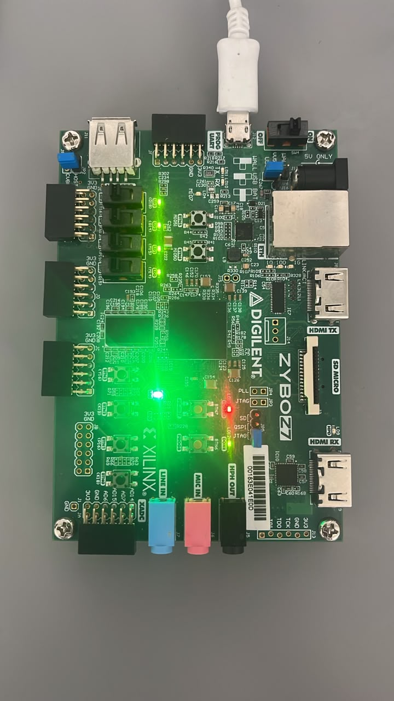

Con los dos operandos cargados y la suma seleccionada (`op = 00`), el LED RGB sigue en verde. Los 4 LEDs que están sobre los switches muestran `1010 + 0101 = 1111`, es decir, los cuatro encendidos.

### Paso 4: Cambio a Operación Resta

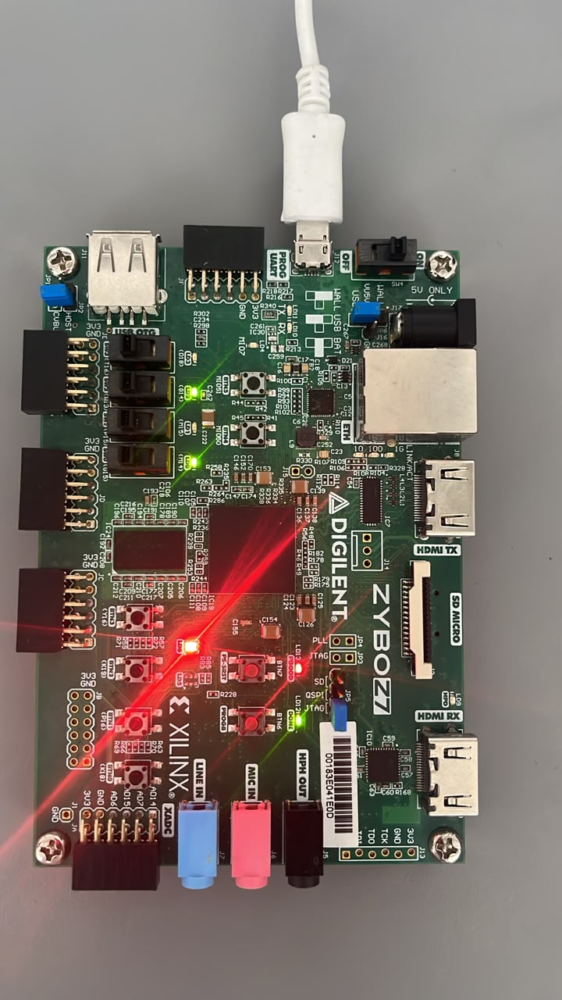

Se presionó `BTN2` para pasar a la resta (`op = 01`). Después de soltar el botón, la operación se mantuvo: el LED RGB cambió a rojo y los LEDs mostraron `1010 - 0101 = 0101`.

### Paso 5: Cambio a Operación Lógica AND

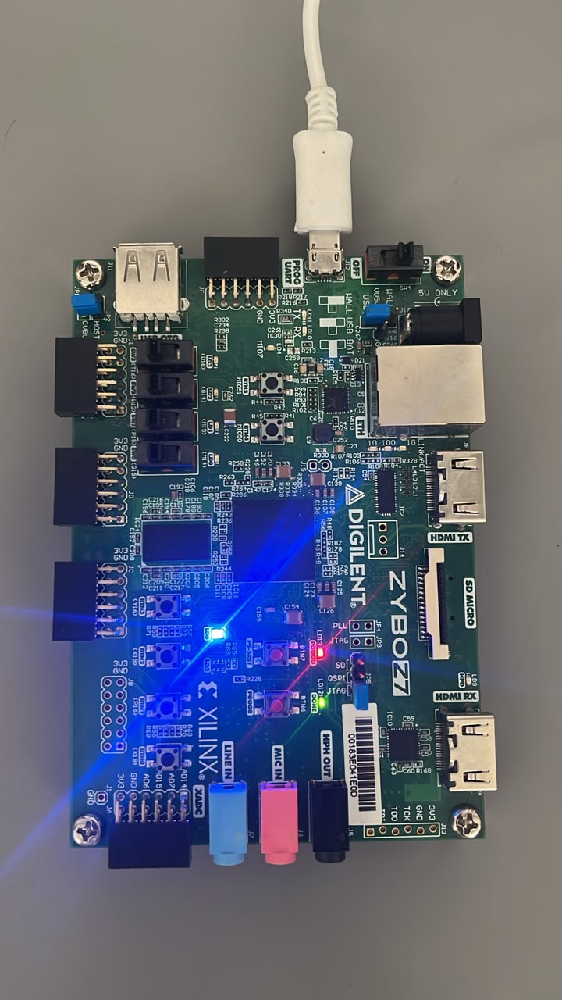

Se seleccionó el AND (`op = 10`) y el LED RGB cambió a azul. Como `1010` y `0101` no tienen ningún `1` en la misma posición, el resultado de `1010 & 0101` es `0000`, y en la foto se ve que los 4 LEDs quedaron apagados.

### Paso 6: Cambio a Operación Lógica OR

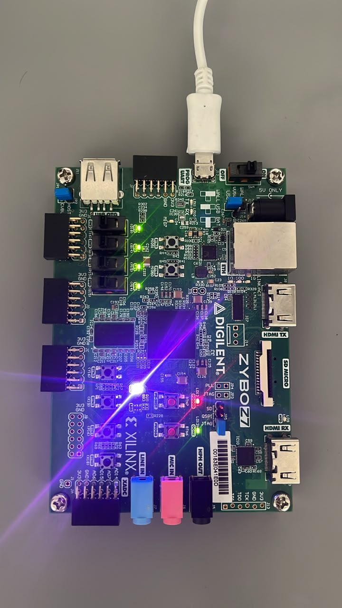

Por último, se seleccionó el OR (`op = 11`) y el LED RGB cambió a morado, el color que escogió el grupo para esta operación. Como `1010 | 0101 = 1111`, los 4 LEDs volvieron a encenderse.

---

## 10. Conclusiones

1. Separar la lógica combinacional de la secuencial facilitó mucho el diseño. Al dejar la ALU en un módulo aparte, sin reloj, quedó un bloque que solo procesa datos y que se puede reutilizar tal cual en los sistemas más grandes de los próximos laboratorios.
2. Los registros permitieron trabajar con las pocas entradas físicas de la FPGA. Al ingresar los datos en momentos distintos, un solo bus de 4 switches fue suficiente para un sistema que en realidad necesita 10 bits (dos operandos de 4 bits y un código de 2 bits).
3. Simular con Icarus Verilog y GTKWave antes de pasar a la tarjeta fue muy útil. Con el testbench se revisaron casos como los resultados negativos en complemento a 2 y los desbordamientos antes de sintetizar, y gracias a eso la ALU funcionó en la Zybo desde la primera prueba.
