```mermaid
graph LR
    SW[Switches 3:0] --> |Bus de Datos| RegA(Registro A)
    SW --> |Bus de Datos| RegB(Registro B)
    
    BTN0((BTN 0)) -.-> |Señal Enable| RegA
    BTN1((BTN 1)) -.-> |Señal Enable| RegB
    BTN2_3((BTN 2 y 3)) --> |Cambio de Bit| RegOp(Registro OpCode)

    RegA --> |4 bits| ALU{ALU 4-bits}
    RegB --> |4 bits| ALU
    RegOp --> |2 bits| ALU

    ALU --> |Resultado 4 bits| LEDs[LEDs Salida]
    RegOp --> |Decodifica Color| RGB[LED RGB]

    style LEDs fill:#CC5500,stroke:#333
    style RGB fill:#CC5500,stroke:#333
    style SW fill:#CC5500,stroke:#333
    style BTN0 fill:#013220,stroke:#333
    style BTN1 fill:#013220,stroke:#333
    style BTN2_3 fill:#013220,stroke:#333
    style ALU fill:#950606,stroke:#333,stroke-width:2px
    style RegA fill:#003153,stroke:#333
    style RegB fill:#003153,stroke:#333
    style RegOp fill:#003153,stroke:#333

```

# Laboratorio 02
## Diseño, simulación e implementación de una ALU de 4 bits

---

## Integrantes  
- Julian David Gomez Gonzalez - 1007544331
- Cristian Norbey Hernández Gualteros - 1001091723
- Milton Nicolas Rincón Caicedo - 1021312724

**Semestre:** 2026-2

---

## Índice
1. [Explicación general del funcionamiento](#1-explicación-general-del-funcionamiento)
2. [Descripción de la arquitectura propuesta](#2-descripción-de-la-arquitectura-propuesta)
3. [Explicación de los módulos desarrollados](#3-explicación-de-los-módulos-desarrollados)
4. [Tabla de operaciones implementadas](#4-tabla-de-operaciones-implementadas)
5. [Almacenamiento de operandos](#5-almacenamiento-de-operandos)
6. [Conservación del código de operación](#6-conservación-del-código-de-operación)
7. [Indicadores visuales (LED RGB)](#7-indicadores-visuales-led-rgb)
8. [Simulaciones y Comportamiento Observado en GTKWave](#8-simulaciones-y-comportamiento-observado-en-gtkwave)
9. [Evidencia de la implementación funcional en FPGA](#9-evidencia-de-la-implementación-funcional-en-fpga)
10. [Conclusiones](#conclusiones)

---

## 1. Explicación general del funcionamiento
> **[MILTON]:** Redacte aquí una descripción global de qué hace el sistema. Mencionar qué es una ALU de 4 bits, cómo el usuario ingresa datos por los switches, usa botones para guardar y seleccionar, y ve el resultado en LEDs.

---

## 2. Descripción de la arquitectura propuesta
La arquitectura de este sistema implementa un Datapath, el cual se diseñó separando estrictamente la lógica secuencial (memoria) de la lógica combinacional (procesamiento). 

El funcionamiento se divide en tres etapas principales:

1. **Capa de Entrada y Almacenamiento (Lógica Secuencial):**
   Dado que los pines físicos de la FPGA son limitados, se utilizó una técnica de multiplexación en el tiempo. El bus de entrada (4 switches) está conectado simultáneamente a los registros `Reg_A` y `Reg_B`. Los botones físicos (`BTN0` y `BTN1`) actúan como señales de habilitación (*Enable*); al presionarlos, el registro correspondiente captura y memoriza el estado actual de los switches. Por otro lado, un tercer registro (`Reg_Op`) almacena el código de operación de 2 bits, cuyo estado es modificado directamente por los botones `BTN2` y `BTN3`. Todos estos registros están sincronizados con la señal de reloj de la tarjeta (`clk`).

2. **Capa de Procesamiento (Lógica Combinacional):**
   Una vez que los datos están seguros en los registros, viajan por cables internos hacia la **ALU**. La ALU es un módulo puramente combinacional: carece de memoria y de reloj. Su función es evaluar continuamente los valores estáticos presentes en `Reg_A`, `Reg_B` y `Reg_Op`, y calcular el resultado matemático o lógico de forma inmediata.

3. **Capa de Salida:**
   El resultado de 4 bits calculado por la ALU se enruta directamente a los LEDs estándar de la placa. En paralelo, el valor almacenado en el `Reg_Op` alimenta un decodificador que enciende el LED RGB con el color asociado a la operación activa.

**Diagrama de Bloques (Datapath)**
**Diagrama de Bloques (Datapath)**

---

## 3. Explicación de los módulos desarrollados
> **[MILTON]:** Detallar los archivos que usted hizo en Verilog (ej. `alu_4bits.v` y `top_system.v`). Explicar qué hace el Top (hardware e instanciación) y qué hace la ALU.
---

## 4. Tabla de operaciones implementadas
A continuación se resumen las operaciones aritméticas y lógicas que la ALU es capaz de ejecutar. Estas funciones se activan mediante un código de control de 2 bits y operan sobre operandos de 4 bits.

| Código de Operación | Operación | Función Ejecutada |
| :---: | :--- | :--- |
| `00` | **Suma** | `A + B` |
| `01` | **Resta** | `A - B` |
| `10` | **AND lógico** | `A AND B` (Bit a bit) |
| `11` | **OR lógico** | `A OR B` (Bit a bit) |

---

## 5. Almacenamiento de operandos
> **[JULIAN]:** Explicar cómo se usan los flip-flops/registros en el código para guardar el Operando A y B, y cómo esto permite cambiar los switches sin afectar los valores ya guardados.

## 6. Conservación del código de operación
> **[JULIAN]:** Explicar cómo funciona el registro de 2 bits que guarda la selección de la operación al presionar BTN2 y BTN3, evitando que el usuario tenga que dejarlos oprimidos.

---

## 7. Indicadores visuales (LED RGB)
Para facilitar la identificación de la operación que se encuentra actualmente guardada y activa en el sistema, se configuró el LED RGB de la placa Zybo Z7. Los colores para las operaciones aritméticas cumplen con lo solicitado en la guía, mientras que los colores para las operaciones lógicas fueron seleccionados por el grupo buscando un alto contraste visual:

| Operación Activa | Color del LED RGB |
| :--- | :--- |
| **Suma** | 🟢 Verde |
| **Resta** | 🔴 Rojo |
| **AND** | 🔵 Azul |
| **OR** | 🟣 Morado |

---

## 8. Simulaciones y Comportamiento Observado en GTKWave
*Nota: Los archivos fuente del testbench (`tb_alu.v`) y las ondas generadas (`alu_tb.vcd`) se encuentran en la carpeta `sim/` de este repositorio. Al igual que las imágenes colocadas en este apartado.*

El testbench fue diseñado para inyectar estímulos de forma estructurada en 6 pruebas distintas. Al analizar las ondas, se comprueba que el hardware simulado responde exactamente a las sentencias de Verilog, validando tanto la matemática como el comportamiento puramente combinacional de la ALU.

### Prueba 1: Operación Suma (`op = 00`)

Se realizaron 4 inyecciones de datos para validar sumas normales y casos de desbordamiento (*overflow* limitados a 4 bits):
*   `0011 + 0100 = 0111`.
*   `0101 + 1010 = 1111` (Valor máximo representable con 4 bits).
*   `1100 + 0111 = 10011`. Al superar el límite de 4 bits, la ALU trunca el bit más significativo y arroja `0011`.
*   `1111 + 0001 = 10000`. De igual forma, el desbordamiento arroja `0000`.

### Prueba 2: Operación Resta (`op = 01`)

Se realizaron 4 inyecciones para comprobar restas directas y el manejo de números negativos mediante complemento a 2:
*   Restas normales: `1001 - 0100 = 0101` y `0111 - 0111 = 0000`.
*   Resultados negativos: `0011 - 0101`. La gráfica muestra un resultado de `1110`, que es la representación correcta de un número negativo (equivalente a `-2` en decimal) usando complemento a 2 para 4 bits. De igual manera, `0000 - 0001` arroja `1111` (equivalente a `-1`).

### Prueba 3: Operación Lógica AND (`op = 10`)

Se realizaron 3 inyecciones para validar la operación "bit a bit" (bitwise). 
*   Al operar `1100 & 1010`, la señal de salida cae a `1000`, encendiendo únicamente la posición donde ambos operandos tienen un `1`. Se verificó también el caso de máscaras opuestas (`1111 & 0101 = 0101`) y la anulación total (`0000 & 1111 = 0000`).

### Prueba 4: Operación Lógica OR (`op = 11`)

Con 3 inyecciones adicionales, se verificó la correcta suma lógica bit a bit.
*   Al operar `1100 | 1010`, el resultado es `1110`. También se probaron casos de bits independientes (`0001 | 0010 = 0011`) y el caso nulo (`0000 | 0000 = 0000`).

### Prueba 5: Mismos operandos, cambio dinámico de operación

En esta prueba se mantuvieron fijos los operandos en `A = 1100` y `B = 1010`, y se varió únicamente el selector `op` pasando por las 4 operaciones (`00`, `01`, `10`, `11`). 
La onda demuestra que la señal `result` se actualiza de manera inmediata (pasando de `0110` a `0010`, luego a `1000` y `1110`). Al no haber retrasos ni depender de flancos de reloj, se certifica el **comportamiento combinacional** exigido en la sección 4.2 del laboratorio.

### Prueba 6: Operador fijo, cambio dinámico de operando A

Finalmente, se fijó la operación en Suma (`op = 00`) y el operando `B = 0010`. Se inyectaron cambios sucesivos únicamente en el operando `A` (`0001`, `0100` y `1000`). La salida `result` acompañó instantáneamente estos cambios (`0011`, `0110` y `1010`), reconfirmando la sensibilidad inmediata de la ALU a cualquier alteración en su bus de datos.

---

## 9. Evidencia de la implementación funcional en FPGA
El diseño fue sintetizado y programado exitosamente en la tarjeta Zybo Z7. Para la demostración física, se evaluó el sistema ingresando los operandos `A = 1010` y `B = 0101`, y transitando por las 4 operaciones disponibles. 

A continuación, se presenta la secuencia fotográfica de la validación en hardware:

### Paso 1: Carga del Operando A

Se posicionaron los switches físicos en `1010` y se presionó el botón de carga (`BTN0`). El valor quedó almacenado de forma persistente en el registro A. En este estado inicial, el LED RGB se muestra en color **Verde** indicando que la operación por defecto activa es la Suma.

### Paso 2: Carga del Operando B

Se modificó la posición de los switches a `0101` y se presionó el botón de carga (`BTN1`). El sistema demostró que es posible cambiar las entradas físicas sin corromper el dato `1010` previamente guardado en el operando A.

### Paso 3: Operación Suma activa

Con ambos operandos cargados y la operación Suma activa (`op = 00`), el LED RGB se mantiene **Verde**. Los 4 LEDs estándar ubicados sobre los switches muestran el resultado combinacional en tiempo real: `1010 + 0101 = 1111` (los cuatro LEDs encendidos).

### Paso 4: Cambio a Operación Resta

Se utilizaron los botones selectores (`BTN2` y `BTN3`) para cambiar el código de operación a Resta (`op = 01`). Tras soltar los botones, el estado se conservó en memoria: el LED RGB cambió a **Rojo** y los LEDs de salida mostraron el resultado correcto: `1010 - 0101 = 0101`.

### Paso 5: Cambio a Operación Lógica AND

Se seleccionó la operación AND (`op = 10`). El LED RGB se iluminó en **Azul**. Dado que los operandos utilizados tienen bits complementarios y no comparten ningún `1` en la misma posición (`1010 & 0101`), el resultado lógico es `0000`. La fotografía evidencia que los 4 LEDs de salida se apagaron correctamente.

### Paso 6: Cambio a Operación Lógica OR

Finalmente, se seleccionó la operación OR (`op = 11`). El LED RGB cambió a **Morado**, cumpliendo con la asignación visual definida por el grupo. El resultado de sumar lógicamente `1010 | 0101` es `1111`, por lo que los 4 LEDs volvieron a encenderse simultáneamente.

---

## 10. Conclusiones

1. Se comprobó la importancia crítica de separar la lógica combinacional de la secuencial. Al aislar la ALU en su propio módulo independiente sin señales de reloj, se obtuvo un bloque de procesamiento puro y estructurado. Esto garantiza que el código sea escalable y fácilmente reutilizable como una "caja negra" para los sistemas de mayor complejidad que se desarrollarán en los próximos laboratorios.
2. El laboratorio demostró cómo el uso de elementos de memoria (Flip-Flops/Registros) permite superar las limitaciones físicas de la FPGA. Mediante la "multiplexación en el tiempo", se logró que un solo bus de 4 switches alimentara un sistema que en la práctica requiere 10 bits simultáneos para operar (dos operandos de 4 bits y un código de 2 bits).
3. El uso de Icarus Verilog y GTKWave fue fundamental para aislar errores. Diseñar un *testbench* riguroso permitió comprobar matemáticamente casos críticos (como el comportamiento en números negativos por complemento a 2 y los desbordamientos) antes de invertir tiempo en la síntesis y programación del hardware físico, garantizando que la ALU funcionara correctamente en la placa Zybo desde el primer intento.
