# Laboratorio 02

## Diseño, simulación e implementación de una ALU de 4 bits

---

## Integrantes  

- Julian David Gomez Gonzalez - 1007544331
- Cristian Norbey Hernández Gualteros - 1001091723
- Milton Nicolas Rincón Caicedo - 1021312724

**Semestre:** 2026-2

---

## Índice

1. [Explicación general del funcionamiento](#1-explicación-general-del-funcionamiento)
2. [Descripción de la arquitectura propuesta](#2-descripción-de-la-arquitectura-propuesta)
3. [Explicación de los módulos desarrollados](#3-explicación-de-los-módulos-desarrollados)
4. [Tabla de operaciones implementadas](#4-tabla-de-operaciones-implementadas)
5. [Almacenamiento de operandos](#5-almacenamiento-de-operandos)
6. [Conservación del código de operación](#6-conservación-del-código-de-operación)
7. [Indicadores visuales (LED RGB)](#7-indicadores-visuales-led-rgb)
8. [Simulaciones y Comportamiento Observado en GTKWave](#8-simulaciones-y-comportamiento-observado-en-gtkwave)
9. [Evidencia de la implementación funcional en FPGA](#9-evidencia-de-la-implementación-funcional-en-fpga)
10. [Conclusiones](#10-conclusiones)

---

## 1. Explicación general del funcionamiento

El sistema implementado en la FPGA Zybo Z7 es una **Unidad Aritmético-Lógica (ALU) de 4 bits**, el bloque de un procesador encargado de realizar las operaciones matemáticas y lógicas sobre los datos. La ALU recibe dos operandos de 4 bits (`A` y `B`) y un código de operación de 2 bits (`op`), y entrega un resultado de 4 bits según la operación seleccionada: suma, resta, AND u OR.

Como la tarjeta solo dispone de 4 switches, los operandos se ingresan uno a la vez a través de un mismo bus de datos:

1. El usuario coloca un valor en los switches `SW[3:0]` y presiona `BTN0`; el valor se guarda en el registro del **Operando A**.
2. Cambia la posición de los switches y presiona `BTN1`; el nuevo valor se guarda en el registro del **Operando B**. A partir de ese momento, mover los switches no altera los operandos almacenados.
3. Cada pulsación de `BTN2` invierte el bit 0 del código de operación y cada pulsación de `BTN3` invierte el bit 1. El código queda guardado en un registro, por lo que no es necesario mantener presionados los botones.
4. La ALU calcula de forma continua el resultado a partir de los valores almacenados y lo muestra en los LEDs `LED[3:0]`.
5. El LED RGB indica con un color la operación activa: Verde (suma), Rojo (resta), Azul (AND) y Morado (OR).

Al encender la tarjeta, todos los registros inician en cero y la operación por defecto es la suma.

---

## 2. Descripción de la arquitectura propuesta

La arquitectura de este sistema implementa un Datapath, el cual se diseñó separando estrictamente la lógica secuencial (memoria) de la lógica combinacional (procesamiento).

El funcionamiento se divide en tres etapas principales:

1. **Capa de Entrada y Almacenamiento (Lógica Secuencial):**
   Dado que los pines físicos de la FPGA son limitados, se utilizó una técnica de multiplexación en el tiempo. El bus de entrada (4 switches) está conectado simultáneamente a los registros `Reg_A` y `Reg_B`. Los botones físicos (`BTN0` y `BTN1`) actúan como señales de habilitación (*Enable*); al presionarlos, el registro correspondiente captura y memoriza el estado actual de los switches. Por otro lado, un tercer registro (`Reg_Op`) almacena el código de operación de 2 bits, cuyo estado es modificado directamente por los botones `BTN2` y `BTN3`. Todos estos registros están sincronizados con la señal de reloj de la tarjeta (`clk`).

2. **Capa de Procesamiento (Lógica Combinacional):**
   Una vez que los datos están seguros en los registros, viajan por cables internos hacia la **ALU**. La ALU es un módulo puramente combinacional: carece de memoria y de reloj. Su función es evaluar continuamente los valores estáticos presentes en `Reg_A`, `Reg_B` y `Reg_Op`, y calcular el resultado matemático o lógico de forma inmediata.

3. **Capa de Salida:**
   El resultado de 4 bits calculado por la ALU se enruta directamente a los LEDs estándar de la placa. En paralelo, el valor almacenado en el `Reg_Op` alimenta un decodificador que enciende el LED RGB con el color asociado a la operación activa.

**Diagrama de Bloques (Datapath)**

```mermaid
graph LR
    SW[Switches 3:0] --> |Bus de Datos| RegA(Registro A)
    SW --> |Bus de Datos| RegB(Registro B)
    
    BTN0((BTN 0)) -.-> |Señal Enable| RegA
    BTN1((BTN 1)) -.-> |Señal Enable| RegB
    BTN2_3((BTN 2 y 3)) --> |Cambio de Bit| RegOp(Registro OpCode)

    RegA --> |4 bits| ALU{ALU 4-bits}
    RegB --> |4 bits| ALU
    RegOp --> |2 bits| ALU

    ALU --> |Resultado 4 bits| LEDs[LEDs Salida]
    RegOp --> |Decodifica Color| RGB[LED RGB]

    style LEDs fill:#CC5500,stroke:#333
    style RGB fill:#CC5500,stroke:#333
    style SW fill:#CC5500,stroke:#333
    style BTN0 fill:#013220,stroke:#333
    style BTN1 fill:#013220,stroke:#333
    style BTN2_3 fill:#013220,stroke:#333
    style ALU fill:#950606,stroke:#333,stroke-width:2px
    style RegA fill:#003153,stroke:#333
    style RegB fill:#003153,stroke:#333
    style RegOp fill:#003153,stroke:#333

```



---

## 3. Explicación de los módulos desarrollados

El diseño se organizó en módulos independientes ubicados en la carpeta `src/`:

| Archivo | Módulo(s) | Tipo de lógica | Función |
| :--- | :--- | :---: | :--- |
| `src/alu.v` | `alu` | Combinacional | Ejecuta la operación indicada por `op` sobre `A` y `B`. |
| `src/almacenamiento.v` | `registro` | Secuencial | Registro de 4 bits con carga; se usa para el Operando A y el Operando B. |
| | `antirrebote` | Secuencial | Sincroniza y filtra un pulsador; entrega un pulso de un ciclo por pulsación. |
| | `control_op` | Secuencial | Registro de 2 bits que guarda el código de operación. |
| `src/top.v` | `top` | Interconexión | Módulo superior: conecta los pines de la FPGA e instancia los demás módulos. |
| | `rgb_decoder` | Combinacional | Convierte el código de operación en el color del LED RGB. |
| `src/lab02.xdc` | — | — | Restricciones de pines de la Zybo Z7 (reloj, switches, botones, LEDs y LED RGB 6). |

### 3.1. Módulo `alu` (lógica combinacional)

Recibe `A[3:0]`, `B[3:0]` y `op[1:0]` y entrega `result[3:0]`. Se describe con un bloque `always @(*)` y una sentencia `case`, de modo que la salida se reevalúa ante cualquier cambio de las entradas y depende únicamente de sus valores actuales: no tiene reloj, no almacena operandos ni resultados y no conserva estados anteriores. El caso `default` garantiza que no se infieran *latches*.

```verilog
always @(*) begin
    case (op)
        2'b00:   result = A + B;   // Suma
        2'b01:   result = A - B;   // Resta
        2'b10:   result = A & B;   // AND bit a bit
        2'b11:   result = A | B;   // OR bit a bit
        default: result = 4'b0000; // Evita latches
    endcase
end
```

La suma y la resta se truncan a 4 bits: los desbordamientos descartan el acarreo y los resultados negativos de la resta quedan en complemento a 2 (ver sección 8).

### 3.2. Módulos de `almacenamiento.v` (lógica secuencial)

Agrupa todos los elementos con memoria del sistema; todos trabajan con `always @(posedge clk)`:

- **`registro`**: registro de 4 bits con entrada de carga `load`. Si `load = 1` copia el dato de los switches; si `load = 0` conserva su valor (sección 5).
- **`antirrebote`**: recibe la señal de un pulsador mecánico y entrega un pulso limpio de un solo ciclo de reloj por cada pulsación. Funciona en tres etapas:
  1. **Sincronizador** de dos flip-flops, que evita la metaestabilidad al llevar una señal asíncrona al dominio del reloj de 125 MHz.
  2. **Filtro de rebotes**: un contador de 21 bits exige que la entrada se mantenga estable durante 10 ms (1 250 000 ciclos) antes de aceptar el cambio.
  3. **Detector de flanco**: genera el pulso solo cuando el estado filtrado pasa de `0` a `1`.
- **`control_op`**: registro de 2 bits del código de operación; cada pulso invierte el bit correspondiente (sección 6).

### 3.3. Módulo `top` (módulo superior)

Se encarga de conectar el diseño con los recursos físicos de la FPGA. **No contiene ninguna operación aritmética ni lógica**; únicamente instancia y conecta:

- Dos instancias de `registro` (`reg_A` y `reg_B`) conectadas al mismo bus `sw`, con `btn[0]` y `btn[1]` como señales de carga.
- Dos instancias de `antirrebote` (`ar_op0` y `ar_op1`) para `btn[2]` y `btn[3]`.
- Una instancia de `control_op` que recibe los pulsos limpios y entrega `reg_op`.
- La `alu`, con entradas `reg_a`, `reg_b` y `reg_op`, y salida conectada directamente a `led[3:0]`.
- El `rgb_decoder`, que recibe `reg_op` y maneja los pines `led6_r`, `led6_g` y `led6_b`.

Los botones de carga (`BTN0` y `BTN1`) no necesitan antirrebote: mientras están presionados, el registro vuelve a cargar el mismo valor de los switches en cada ciclo, por lo que los rebotes no alteran el resultado. En cambio, los botones de operación invierten un bit, y sin antirrebote cada rebote (o cada ciclo de reloj con el botón presionado) produciría una inversión adicional.

### 3.4. Módulo `rgb_decoder` (lógica combinacional)

Decodificador incluido en `top.v` que traduce el código de operación a las tres señales `{r, g, b}` del LED RGB (ver sección 7).

---

## 4. Tabla de operaciones implementadas

A continuación se resumen las operaciones aritméticas y lógicas que la ALU es capaz de ejecutar. Estas funciones se activan mediante un código de control de 2 bits y operan sobre operandos de 4 bits.

| Código de Operación | Operación | Función Ejecutada |
| :---: | :--- | :--- |
| `00` | **Suma** | `A + B` |
| `01` | **Resta** | `A - B` |
| `10` | **AND lógico** | `A AND B` (Bit a bit) |
| `11` | **OR lógico** | `A OR B` (Bit a bit) |

---

## 5. Almacenamiento de operandos

Para permitir el procesamiento de dos operandos independientes de 4 bits (`A` y `B`) contando únicamente con 4 interruptores físicos (`SW[3:0]`) en la tarjeta Zybo Z7, se diseñó un esquema secuencial de **almacenamiento mediante registros con habilitador de carga (*Clock Enable*)**, aplicando la técnica de **multiplexación en el tiempo**.

### 5.1. Arquitectura de los Registros (Flip-Flops Tipo D)

El almacenamiento se implementa internamente a través de dos registros de 4 bits: `Reg_A` y `Reg_B`. En la FPGA, cada uno de estos registros se sintetiza como un conjunto de **4 Flip-Flops tipo D** síncronos con el reloj del sistema (`clk`).
- **Bus común de datos:** Las entradas de datos ($D$) de ambos registros se encuentran conectadas en paralelo al mismo bus de 4 bits proveniente de los interruptores (`SW[3:0]`).
- **Señales de habilitación independientes (*Enable*):** Cada banco de Flip-Flops cuenta con una línea de control de carga independiente conectada a los pulsadores físicos:
  - `BTN0` actúa como la señal de habilitación (*Load Enable*) para `Reg_A`.
  - `BTN1` actúa como la señal de habilitación (*Load Enable*) para `Reg_B`.

### 5.2. Implementación en Código Verilog

El registro se describe una sola vez en el módulo `registro` (`src/almacenamiento.v`), mediante un bloque `always` sincronizado con el flanco ascendente del reloj y una asignación no bloqueante (`<=`):

```verilog
module registro (
    input  wire       clk,
    input  wire       load,           // 1 = cargar el dato, 0 = conservar
    input  wire [3:0] d,              // dato de entrada (bus de switches)
    output reg  [3:0] q = 4'b0000     // valor guardado (arranca en 0)
);
    always @(posedge clk) begin
        if (load)
            q <= d;     // captura el valor de los switches
        // si load = 0 no se asigna nada: q conserva su valor
    end
endmodule
```

En el módulo `top` se instancia dos veces, una para cada operando, ambas conectadas al mismo bus `sw`:

```verilog
registro reg_A (.clk(clk), .load(btn[0]), .d(sw), .q(reg_a));
registro reg_B (.clk(clk), .load(btn[1]), .d(sw), .q(reg_b));
```

### 5.3. Principio de Aislamiento y Persistencia de Datos
El uso de registros con habilitación condicional es la clave que permite modificar libremente la posición de los switches sin corromper ni alterar los valores previamente guardados:

1. **Estado de retención (*Hold*):** Cuando un botón no se encuentra presionado (`btn = 0`), la condición de carga no se cumple. En cada flanco positivo de `clk`, los Flip-Flops tipo D mantienen inalterado su estado previo ($Q_{t+1} = Q_t$), ignorando cualquier cambio o conmutación que ocurra en el bus `sw`.
2. **Aislamiento entre operandos:** Al cargar el operando A mediante `BTN0`, el valor queda memorizado. Posteriormente, el usuario puede mover los switches para configurar el operando B; debido a que `BTN0` está inactivo (`0`), el valor de `Reg_A` permanece completamente aislado y protegido. Únicamente al presionar `BTN1` se actualiza `Reg_B`.
3. **Alimentación estática a la ALU:** Las salidas de ambos registros (`reg_A` y `reg_B`) quedan fijas y disponibles de manera simultánea en las entradas de la ALU. Gracias a esto, el módulo combinacional de la ALU evalúa en tiempo real las operaciones matemáticas y lógicas sobre los dos operandos sin fluctuaciones ni dependencias del estado transitorio de los interruptores físicos.

---

## 6. Conservación del código de operación

Para garantizar un funcionamiento estable del sistema y evitar que el usuario deba mantener oprimidos físicamente los pulsadores durante la ejecución o lectura de los resultados, se diseñó un mecanismo de memoria secuencial para el código de operación (`op`).

### 6.1. Limitación de las Entradas Momentáneas (Pulsadores)
Los pulsadores de la placa Zybo Z7 (`BTN0` a `BTN3`) son dispositivos de contacto momentáneo (*push buttons*): generan un nivel lógico alto (`1`) únicamente mientras se ejerce presión física sobre ellos y retornan inmediatamente a nivel bajo (`0`) al ser liberados.

Si el bus selector de operaciones de la ALU (`op[1:0]`) estuviese conectado directamente de forma combinacional a los botones (`op = {BTN3, BTN2}`):
* El código de operación deseado sólo existiría durante el breve instante en que el usuario mantenga el dedo sobre el botón.
* Al soltar el botón, el sistema caería de inmediato a la operación por defecto `00` (Suma).
* Operaciones como el OR lógico (`op = 11`) requerirían que el usuario sostuviera dos botones oprimidos al mismo tiempo con ambas manos mientras intenta observar los LEDs, lo cual resulta impráctico e inestable.

### 6.2. Registro de Estado de 2 Bits (`Reg_Op`)
Para resolver esta limitación, se implementó un registro secuencial de 2 bits denominado `Reg_Op` (`reg [1:0] reg_op`), compuesto por **dos Flip-Flops tipo D** síncronos al reloj `clk`.

Este registro actúa como una memoria de estado estable donde cada pulsador tiene asignada la conmutación y actualización de un bit específico del código:
* **`BTN2` (Bit Menos Significativo - LSB):** Modifica el valor del bit `reg_op[0]`.
* **`BTN3` (Bit Más Significativo - MSB):** Modifica el valor del bit `reg_op[1]`.

Gracias a esta arquitectura, un pulso rápido en `BTN2` o `BTN3` cambia el bit correspondiente, y el nuevo valor queda "enganchado" (*latched*) de forma permanente en los Flip-Flops.

### 6.3. Implementación en Código Verilog
El registro `Reg_Op` se implementa en el módulo `control_op` (`src/almacenamiento.v`). El valor inicial por defecto es `2'b00` (Suma), coherente con el encendido inicial del LED RGB en color verde.

Un detalle importante es que el registro **no** se controla directamente con el nivel de los botones. Con un reloj de 125 MHz, una pulsación humana (≈ 100 ms) dura más de 12 millones de ciclos; si el bit se invirtiera en cada ciclo mientras el botón está presionado, el valor final sería aleatorio. Además, el contacto mecánico rebota varias veces al presionarlo. Por eso cada botón pasa primero por el módulo `antirrebote` (sección 3.2), que entrega **un único pulso de un ciclo** por pulsación, y es ese pulso el que invierte el bit:

```verilog
module control_op (
    input  wire       clk,
    input  wire       pulso_bit0,     // pulso limpio de BTN2
    input  wire       pulso_bit1,     // pulso limpio de BTN3
    output reg  [1:0] op = 2'b00      // arranca en 00 (suma)
);
    always @(posedge clk) begin
        if (pulso_bit0)
            op[0] <= ~op[0];          // invierte el bit 0
        if (pulso_bit1)
            op[1] <= ~op[1];          // invierte el bit 1
    end
endmodule
```

Así, partiendo de Suma, la secuencia de operaciones es: Suma `00` → (BTN2) → Resta `01` → (BTN3) → OR `11` → (BTN2) → AND `10` → (BTN3) → Suma `00`.

> **Comportamiento en Hardware:** Cada pulsación genera un solo pulso, y en el flanco de reloj en que llega el pulso el flip-flop correspondiente invierte su estado una única vez. Cuando el usuario retira el dedo (`btn = 0`), los Flip-Flops entran en modo de **retención (*Hold*)**, conservando indefinidamente el código binario sin importar que los botones físicos se hayan liberado.

### 6.4. Estabilidad del Datapath e Indicación Visual
La persistencia que brinda `Reg_Op` proporciona dos beneficios fundamentales para el funcionamiento global del circuito:
1. **Control ininterrumpido de la ALU:** El código de 2 bits viaja de forma permanente hacia el selector de la ALU combinacional, asegurando que el cálculo activo (`A + B`, `A - B`, `A & B`, o `A | B`) se mantenga procesándose y exhibiéndose de manera continua y estática en los 4 LEDs de salida.
2. **Retroalimentación en el LED RGB:** La señal almacenada en `Reg_Op` alimenta de forma ininterrumpida el decodificador de color (Sección 7). Como se evidencia en las pruebas físicas (Sección 9, Pasos 3 al 6), tras presionar y soltar los pulsadores, el LED RGB permanece fijo en el color correspondiente (Verde, Rojo, Azul o Morado), brindando certeza visual inmediata de la operación retenida en memoria sin necesidad de contacto físico continuo.

---

## 7. Indicadores visuales (LED RGB)

Para facilitar la identificación de la operación que se encuentra actualmente guardada y activa en el sistema, se configuró el LED RGB de la placa Zybo Z7. Los colores para las operaciones aritméticas cumplen con lo solicitado en la guía, mientras que los colores para las operaciones lógicas fueron seleccionados por el grupo buscando un alto contraste visual:

| Código `op` | Operación Activa | Color del LED RGB | `{R, G, B}` |
| :---: | :--- | :--- | :---: |
| `00` | **Suma** | 🟢 Verde | `010` |
| `01` | **Resta** | 🔴 Rojo | `100` |
| `10` | **AND** | 🔵 Azul | `001` |
| `11` | **OR** | 🟣 Morado | `101` |

El color se genera en el módulo combinacional `rgb_decoder` a partir del valor almacenado en `reg_op`, y se envía al LED RGB 6 (LD6) de la tarjeta, presente tanto en la Zybo Z7-10 como en la Z7-20. El morado se obtiene encendiendo simultáneamente los canales rojo y azul. Como el color depende del registro y no de los botones, permanece después de soltarlos.

---

## 8. Simulaciones y Comportamiento Observado en GTKWave

*Nota: Los archivos fuente del testbench (`tb_alu.v`) y las ondas generadas (`alu_tb.vcd`) se encuentran en la carpeta `sim/` de este repositorio. Al igual que las imágenes colocadas en este apartado.*

Para reproducir la simulación desde la raíz del repositorio:

```bash
iverilog -o sim/alu_tb.out src/alu.v sim/tb_alu.v
cd sim && vvp alu_tb.out
gtkwave alu_tb.vcd
```

El testbench fue diseñado para inyectar estímulos de forma estructurada en 6 pruebas distintas. Al analizar las ondas, se comprueba que el hardware simulado responde exactamente a las sentencias de Verilog, validando tanto la matemática como el comportamiento puramente combinacional de la ALU.

### Prueba 1: Operación Suma (`op = 00`)


Se realizaron 4 inyecciones de datos para validar sumas normales y casos de desbordamiento (*overflow* limitados a 4 bits):

- `0011 + 0100 = 0111`.
- `0101 + 1010 = 1111` (Valor máximo representable con 4 bits).
- `1100 + 0111 = 10011`. Al superar el límite de 4 bits, la ALU trunca el bit más significativo y arroja `0011`.
- `1111 + 0001 = 10000`. De igual forma, el desbordamiento arroja `0000`.

### Prueba 2: Operación Resta (`op = 01`)


Se realizaron 4 inyecciones para comprobar restas directas y el manejo de números negativos mediante complemento a 2:

- Restas normales: `1001 - 0100 = 0101` y `0111 - 0111 = 0000`.
- Resultados negativos: `0011 - 0101`. La gráfica muestra un resultado de `1110`, que es la representación correcta de un número negativo (equivalente a `-2` en decimal) usando complemento a 2 para 4 bits. De igual manera, `0000 - 0001` arroja `1111` (equivalente a `-1`).

### Prueba 3: Operación Lógica AND (`op = 10`)


Se realizaron 3 inyecciones para validar la operación "bit a bit" (bitwise).

- Al operar `1100 & 1010`, la señal de salida cae a `1000`, encendiendo únicamente la posición donde ambos operandos tienen un `1`. Se verificó también el caso de máscaras opuestas (`1111 & 0101 = 0101`) y la anulación total (`0000 & 1111 = 0000`).

### Prueba 4: Operación Lógica OR (`op = 11`)


Con 3 inyecciones adicionales, se verificó la correcta suma lógica bit a bit.

- Al operar `1100 | 1010`, el resultado es `1110`. También se probaron casos de bits independientes (`0001 | 0010 = 0011`) y el caso nulo (`0000 | 0000 = 0000`).

### Prueba 5: Mismos operandos, cambio dinámico de operación


En esta prueba se mantuvieron fijos los operandos en `A = 1100` y `B = 1010`, y se varió únicamente el selector `op` pasando por las 4 operaciones (`00`, `01`, `10`, `11`).
La onda demuestra que la señal `result` se actualiza de manera inmediata (pasando de `0110` a `0010`, luego a `1000` y `1110`). Al no haber retrasos ni depender de flancos de reloj, se certifica el **comportamiento combinacional** exigido en la sección 4.2 del laboratorio.

### Prueba 6: Operador fijo, cambio dinámico de operando A


Finalmente, se fijó la operación en Suma (`op = 00`) y el operando `B = 0010`. Se inyectaron cambios sucesivos únicamente en el operando `A` (`0001`, `0100` y `1000`). La salida `result` acompañó instantáneamente estos cambios (`0011`, `0110` y `1010`), reconfirmando la sensibilidad inmediata de la ALU a cualquier alteración en su bus de datos.

---

## 9. Evidencia de la implementación funcional en FPGA

El diseño fue sintetizado y programado exitosamente en la tarjeta Zybo Z7. Para la demostración física, se evaluó el sistema ingresando los operandos `A = 1010` y `B = 0101`, y transitando por las 4 operaciones disponibles.

A continuación, se presenta la secuencia fotográfica de la validación en hardware:

### Paso 1: Carga del Operando A


Se posicionaron los switches físicos en `1010` y se presionó el botón de carga (`BTN0`). El valor quedó almacenado de forma persistente en el registro A. En este estado inicial, el LED RGB se muestra en color **Verde** indicando que la operación por defecto activa es la Suma.

### Paso 2: Carga del Operando B


Se modificó la posición de los switches a `0101` y se presionó el botón de carga (`BTN1`). El sistema demostró que es posible cambiar las entradas físicas sin corromper el dato `1010` previamente guardado en el operando A.

### Paso 3: Operación Suma activa


Con ambos operandos cargados y la operación Suma activa (`op = 00`), el LED RGB se mantiene **Verde**. Los 4 LEDs estándar ubicados sobre los switches muestran el resultado combinacional en tiempo real: `1010 + 0101 = 1111` (los cuatro LEDs encendidos).

### Paso 4: Cambio a Operación Resta


Se utilizaron los botones selectores (`BTN2` y `BTN3`) para cambiar el código de operación a Resta (`op = 01`). Tras soltar los botones, el estado se conservó en memoria: el LED RGB cambió a **Rojo** y los LEDs de salida mostraron el resultado correcto: `1010 - 0101 = 0101`.

### Paso 5: Cambio a Operación Lógica AND


Se seleccionó la operación AND (`op = 10`). El LED RGB se iluminó en **Azul**. Dado que los operandos utilizados tienen bits complementarios y no comparten ningún `1` en la misma posición (`1010 & 0101`), el resultado lógico es `0000`. La fotografía evidencia que los 4 LEDs de salida se apagaron correctamente.

### Paso 6: Cambio a Operación Lógica OR


Finalmente, se seleccionó la operación OR (`op = 11`). El LED RGB cambió a **Morado**, cumpliendo con la asignación visual definida por el grupo. El resultado de sumar lógicamente `1010 | 0101` es `1111`, por lo que los 4 LEDs volvieron a encenderse simultáneamente.

---

## 10. Conclusiones

1. Se comprobó la importancia crítica de separar la lógica combinacional de la secuencial. Al aislar la ALU en su propio módulo independiente sin señales de reloj, se obtuvo un bloque de procesamiento puro y estructurado. Esto garantiza que el código sea escalable y fácilmente reutilizable como una "caja negra" para los sistemas de mayor complejidad que se desarrollarán en los próximos laboratorios.
2. El laboratorio demostró cómo el uso de elementos de memoria (Flip-Flops/Registros) permite superar las limitaciones físicas de la FPGA. Mediante la "multiplexación en el tiempo", se logró que un solo bus de 4 switches alimentara un sistema que en la práctica requiere 10 bits simultáneos para operar (dos operandos de 4 bits y un código de 2 bits).
3. El uso de Icarus Verilog y GTKWave fue fundamental para aislar errores. Diseñar un *testbench* riguroso permitió comprobar matemáticamente casos críticos (como el comportamiento en números negativos por complemento a 2 y los desbordamientos) antes de invertir tiempo en la síntesis y programación del hardware físico, garantizando que la ALU funcionara correctamente en la placa Zybo desde el primer intento.
